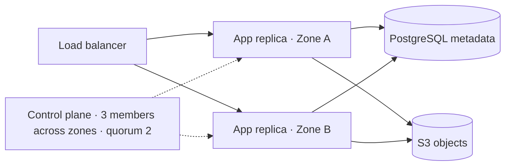

# Cloud-native architecture

## High availability

Run three control-plane members across failure domains so the etcd quorum survives one loss. Spread app replicas across worker nodes and zones. A load balancer sends traffic to ready backends.



### Stop one worker

Use [kind v0.33.0](https://github.com/kubernetes-sigs/kind/releases/tag/v0.33.0) and Docker. From this directory, create a disposable cluster with two workers and deploy two web replicas.

```sh
kind create cluster --name workshop-ha --config kind.yaml
kubectl --context kind-workshop-ha apply -f web.yaml
kubectl --context kind-workshop-ha rollout status deployment/ha-web --timeout=2m
kubectl --context kind-workshop-ha get pods -o wide
curl --fail --max-time 5 http://127.0.0.1:18080/
docker stop workshop-ha-worker2
curl --fail --max-time 5 http://127.0.0.1:18080/
kind delete cluster --name workshop-ha
```

Each worker starts with one replica. The local address goes through the surviving worker. This lab shows workload redundancy. A production load balancer can also route around failed nodes.

## NFS or S3

Choose **NFS** when apps need a mounted directory and shared filesystem operations. Choose **S3** when apps can upload and download whole objects by key through an API.

For uploads, put the bytes in S3 and keep the **object key, owner, and status** in PostgreSQL. Use a unique upload ID per owner. Reserve a row as `pending`, then mark it `ready` after upload. On a retry, reuse the row and key. Use a [conditional write](https://docs.aws.amazon.com/AmazonS3/latest/userguide/conditional-writes.html) and check the checksum if the object already exists.

Discuss what a retry does if the app stops after writing the object and before marking it `ready`.
